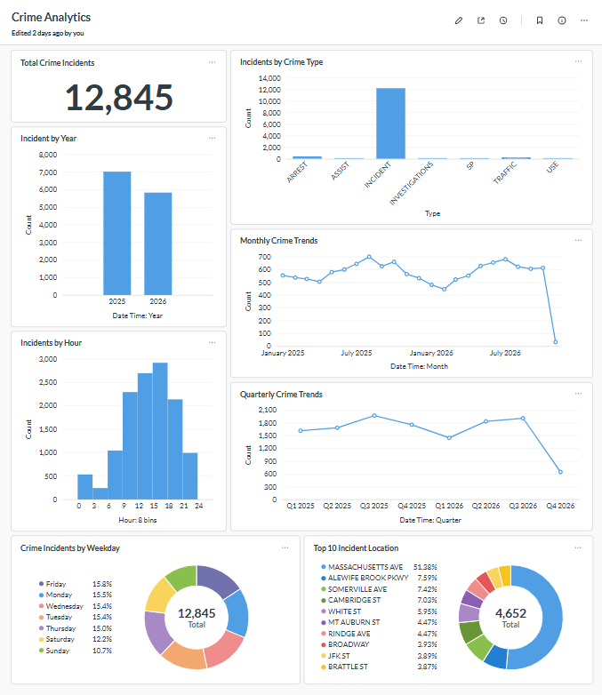

# Crime Data Pipeline

An automated ETL (Extract, Transform, Load) pipeline for collecting, validating, transforming, and storing crime incident data using Python, Prefect, PostgreSQL, Docker, and Metabase.

## Project Overview

The Crime Data Pipeline automates the processing of crime incident data published by the Cambridge Police Department.

The pipeline extracts data from a public Socrata API, validates and transforms the records, and loads them into a PostgreSQL database. Prefect is used to orchestrate and schedule pipeline execution, while Metabase provides interactive dashboards for data visualisation and analysis.

## Project Architecture

The pipeline follows these stages:

1. **Extract:** Fetch crime incident records from the Cambridge Police Department's public API.
2. **Validate:** Check required fields, validate data types, and remove duplicate records.
3. **Transform:** Convert date and time fields and generate additional analytical fields.
4. **Load:** Store processed records in PostgreSQL using an UPSERT operation.
5. **Orchestrate:** Use Prefect to manage and schedule pipeline execution.
6. **Visualise:** Connect Metabase to PostgreSQL to create interactive crime dashboards.

## Technologies Used

| Technology | Purpose |
|---|---|
| Python | ETL development |
| Prefect | Workflow orchestration and scheduling |
| PostgreSQL | Database storage |
| SQLAlchemy | Database operations |
| Docker Compose | Running application services |
| Metabase | Dashboard and data visualisation |
| Socrata API | Crime data source |
| Git and GitHub | Version control and project hosting |

## Dashboard Preview

The following screenshot shows the crime data dashboard created using Metabase.



## Project Structure

```text
Crime-Data-Pipeline/
│
├── src/
│   ├── __init__.py
│   ├── extract.py
│   ├── validate.py
│   ├── transform.py
│   ├── load.py
│   └── main.py
│
├── tests/
│   ├── __init__.py
│   ├── test_load.py
│   └── test_transform.py
│
├── screenshots/
│   └── dashboard.png
│
├── docker-compose.yml
├── requirements.txt
├── .gitignore
└── README.md
```

## Data Source

- **Source:** Cambridge Police Department
- **Platform:** Socrata Open Data API
- **Dataset ID:** `3gki-wyrb`
- **API Domain:** `data.cambridgema.gov`

Data is retrieved from the publicly available crime incident dataset.

## Prerequisites

Before running the project, install:

- Python 3.11
- Docker Desktop
- Git
- A Socrata API application token

## Installation and Setup

### 1. Clone the repository

```bash
git clone https://github.com/Gurvir009/Crime-Data-Pipeline.git
cd Crime-Data-Pipeline
```

### 2. Create a Python virtual environment

```bash
python -m venv .venv
```

Activate it on Windows PowerShell:

```powershell
.venv\Scripts\Activate.ps1
```

### 3. Install dependencies

```bash
pip install -r requirements.txt
```

### 4. Configure environment variables

Create a `.env` file in the project root directory.

Add the required configuration values, including your Socrata API token and database connection settings, using the variable names expected by the application and Docker Compose configuration.

**Important:** Never upload your `.env` file or expose API tokens and database passwords on GitHub.

### 5. Start Docker services

```bash
docker compose up -d
```

This starts the configured PostgreSQL and Metabase services, along with the other services defined in Docker Compose.

### 6. Start the Prefect server

Open a separate terminal and run:

```bash
prefect server start
```

### 7. Start the pipeline deployment

In another terminal, activate the virtual environment and run:

```bash
python -m src.main
```

This starts the Prefect deployment-serving process.

## Accessing the Services

| Service | Local URL |
|---|---|
| Metabase Dashboard | http://localhost:3000 |
| Prefect UI | http://127.0.0.1:4200 |
| pgAdmin | http://localhost:5050 |

The Metabase dashboard can be configured to connect to the PostgreSQL database containing the processed crime incident data.

## Automated Scheduling

The pipeline uses Prefect to schedule automatic execution.

- **Deployment:** `cpd-incident-deployment`
- **Frequency:** Daily
- **Scheduled time:** 8:35 PM IST (3:05 PM UTC)

The Prefect server and deployment-serving process must remain running for scheduled executions in the current local setup.

## Key Features

- Automated crime data extraction from a public API.
- Data validation and duplicate removal.
- Date and time transformation.
- PostgreSQL data storage.
- UPSERT operations to insert new records and update existing records.
- Prefect-based workflow orchestration.
- Scheduled pipeline execution.
- Interactive dashboard visualisation using Metabase.
- Docker-based service management.

## Future Improvements

- Deploy the complete pipeline on a cloud platform.
- Host the dashboard so it can be accessed from different computers over the internet.
- Implement cloud-based database storage.
- Improve monitoring, logging, and failure notifications.

## Author

**Gurvir**

GitHub: [Gurvir009](https://github.com/Gurvir009)

Project Repository: [Crime Data Pipeline](https://github.com/Gurvir009/Crime-Data-Pipeline)
